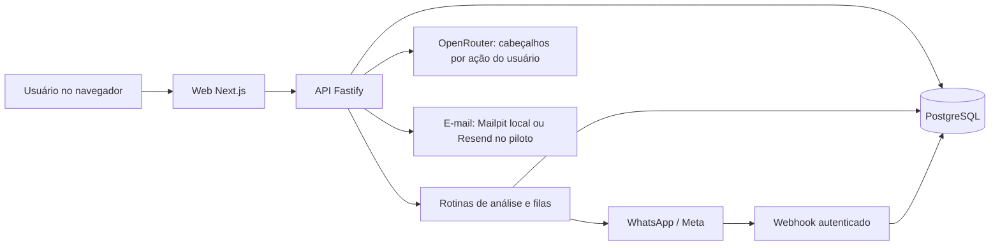

# Arquitetura e fluxos

## Componentes

| Componente | Responsabilidade | Código |
| --- | --- | --- |
| Web Next.js/React | Interface pública, demonstração, autenticação e área operacional. | [apps/web](../apps/web) |
| API Fastify/TypeScript | Sessões, permissões, estoque, importação, análises e integrações. | [app.ts](../apps/api/src/app.ts) |
| PostgreSQL/Prisma | Persistência, transações, restrições e migrations. | [schema](../apps/api/prisma/schema.prisma) |
| Contratos TypeScript | Tipos compartilhados e políticas analíticas padrão. | [contracts](../packages/contracts/src/index.ts) |
| Workers na API | Análise periódica, fila de e-mail e mensagens WhatsApp. | [server.ts](../apps/api/src/server.ts) |

As rotinas executam dentro do processo da API. Não há um serviço de worker independente. A persistência permite retomar pendências; a API precisa permanecer em execução.

## Modelo de dados

- Usuários possuem sessões e vínculos com propriedades. Papéis: ADMIN, OPERATOR e VIEWER.
- Propriedades possuem categorias, produtos, lotes, importações, análises e ocorrências de alerta.
- Movimentações têm quantidade decimal, lote, autoria, data do fato e registro de origem quando aplicável.
- Estorno é uma movimentação vinculada ao registro original; o histórico não é apagado para corrigir uma saída.
- Análises são identificadas por propriedade, revisão do estoque, política, data local e versão das regras.
- Convites e alterações de conta têm validações e registros próprios. E-mails usam fila persistida e conteúdo cifrado.
- WhatsApp mantém códigos em hash, conexões e caixas persistidas com conteúdo cifrado.

O [schema Prisma](../apps/api/prisma/schema.prisma) e as [migrations](../apps/api/prisma/migrations) são a referência completa dos campos e restrições.

## Atualização de estoque e reanálise

1. A API valida sessão, vínculo, papel e dados da operação.
2. A gravação revalida acesso e saldo dentro da transação e dos bloqueios pertinentes.
3. O movimento e a revisão da propriedade são persistidos.
4. A análise fica pendente e é reavaliada pela rotina periódica, normalmente a cada dez segundos.
5. Painel e produto exibem resultado atual, pendente, desatualizado ou com erro, conforme o estado real.

Entradas, saídas, estornos, parâmetros e mudanças relevantes invalidam o resultado correspondente. A data local da propriedade também participa da avaliação, para vencimentos mudarem mesmo sem movimentação.

Referências: [stock-service](../apps/api/src/stock-service.ts), [analysis-service](../apps/api/src/analysis-service.ts) e [analysis-routes](../apps/api/src/analysis-routes.ts).

## Importação e IA

O usuário escolhe posição de estoque ou histórico, envia CSV/XLSX, associa colunas, revisa os registros e confirma. A IA é opcional: OpenRouter recebe somente os cabeçalhos quando o usuário solicita a sugestão de associação. Leitura, validação e gravação dos registros continuam no backend; uma sugestão não altera o estoque diretamente.

Referências: [parser](../apps/api/src/import-parser.ts), [adaptador de IA](../apps/api/src/import-ai.ts) e [fluxo de importação](../apps/api/src/stock-import.ts).

## WhatsApp

1. Usuário autenticado gera um código curto na propriedade escolhida.
2. O código chega em uma mensagem ao número empresarial e é verificado no mesmo ambiente que o emitiu.
3. A API confirma validade, uso único, sessão e participação na propriedade antes de criar o vínculo.
4. Perguntas por texto são processadas por comandos/palavras-chave. O acesso é conferido ao ler e antes de enviar dados.
5. Uma fila persistida envia a resposta e registra os estados informados pela Meta. Aceite não comprova entrega.

O POST do webhook valida HMAC-SHA256 sobre o corpo original. Sua exceção de origem/CSRF é restrita à rota do webhook; rotas de navegador continuam protegidas. IDs de evento impedem repetir o processamento. Falha ambígua de envio não provoca reenvio cego.

Código de oito caracteres, validade de dez minutos, cinco tentativas por remetente e mil globais em dez minutos. O ambiente local direciona ao site publicado; bancos e contas não são compartilhados.

Referências: [receptor](../apps/api/src/whatsapp-routes.ts), [conta e vínculo](../apps/api/src/whatsapp-account.ts), [worker](../apps/api/src/whatsapp-service.ts) e [consultas](../apps/api/src/whatsapp-query.ts).

## Ambientes e limites operacionais

Local: web/API e PostgreSQL/Mailpit próprios. Piloto: containers web/API/PostgreSQL na Oracle, entrada HTTPS pela Cloudflare e envio de e-mail pelo Resend. Configurações privadas ficam fora do Git.

A demonstração pública usa fixtures, sem persistir operações em contas reais. Não confundir esse modo com o painel autenticado. Backups externos automáticos e acompanhamento operacional contínuo permanecem melhorias pendentes. Consulte [Operação](../deploy/OPERATIONS.md).
